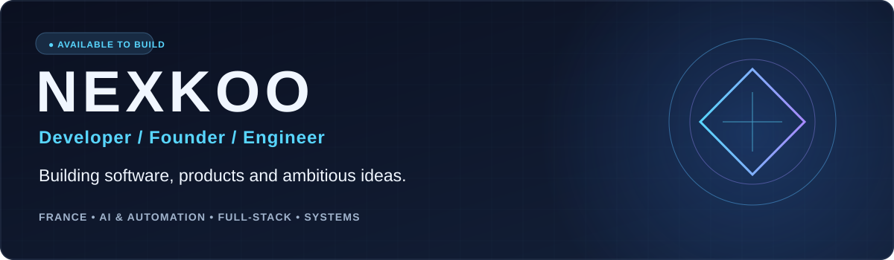
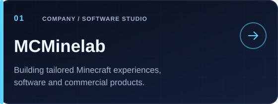
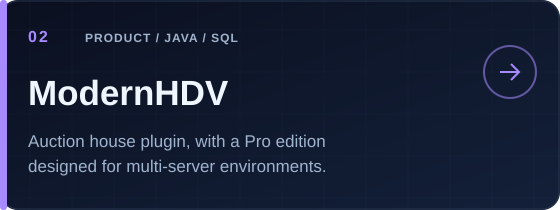
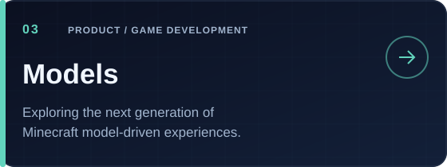
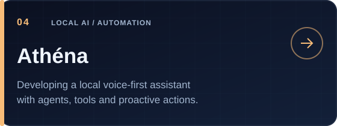
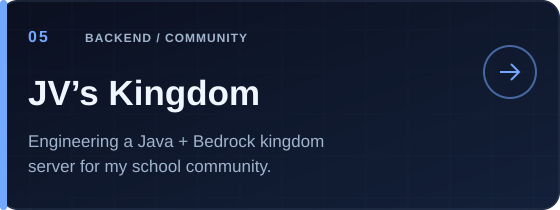
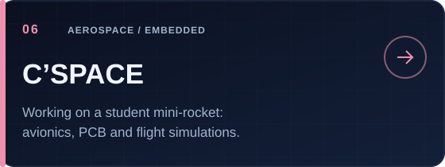
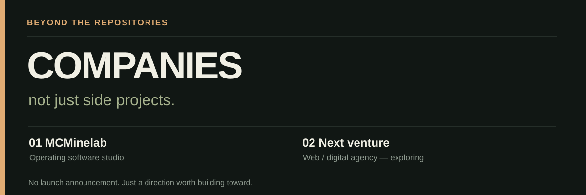
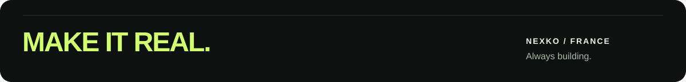

<div align="center">



[](https://mcminelab.fr)
[](https://github.com/Nexkoo)
[](mailto:contact@mcminelab.fr)

</div>

### `> whoami`

I'm a **French student, software developer and entrepreneur**. I enjoy turning ambitious ideas into products — from production-grade Minecraft plugins and full-stack platforms to local AI agents and embedded electronics.

I founded **[MCMinelab](https://mcminelab.fr)** and I keep experimenting across software, AI, infrastructure and engineering. I care about **building things that actually ship**, not just collecting technologies.

```text
current_focus = ["Software products", "AI agents", "Building businesses"]
philosophy    = "Build. Learn. Ship. Repeat."
```

### `> featured_work`

<table>
<tr><td width="50%"><a href="https://mcminelab.fr"></a></td><td width="50%"></td></tr>
<tr><td></td><td></td></tr>
<tr><td></td><td></td></tr>
</table>

<details>
<summary><b>Explore the projects ↗</b></summary>

| Project | What I'm building | Stage |
|:--|:--|:--|
| **[MCMinelab](https://mcminelab.fr)** | Founded a Minecraft software studio, offering custom solutions and products. | Operating |
| **ModernHDV** | Free / Pro auction-house plugin built around Java and database-backed features, including multi-server support. | Released / evolving |
| **Models** | Minecraft-focused model software and experiments; a current product direction. | In development |
| **Athéna** | Local, voice-first AI assistant; agents, tools, scheduled actions and integrations are part of the roadmap. | Prototype / development |
| **JV's Kingdom** | Technical leadership and backend engineering of a school Minecraft server: economy, kingdoms, claims and cross-edition access. | Development |
| **C'SPACE** | Student mini-rocket project: electronics, sensor integration, PCB design and simulations. | Design / qualification prep |

*Some projects are in private repositories or are not yet published. Public links are included only when available.*
</details>

### `> technology_archive`

**A broad snapshot of technologies I've worked with or explored** — not a claim of equal proficiency in every tool.

| Area | Technologies & ecosystems |
|:--|:--|
| **Languages & markup** | Java · Python · TypeScript · JavaScript · Go (learning) · SQL · HTML · CSS |
| **Web & application** | React · Next.js · Node.js ecosystem · Tailwind CSS · REST APIs · Stripe |
| **Backend & data** | Paper / Spigot / Bukkit APIs · SQLite · MySQL · JDBC · Gradle · cross-server systems |
| **AI & automation** | LLM APIs · AI agents · MCP concepts · voice processing · VAD · Silero VAD · local assistants |
| **Tools & infrastructure** | Git · GitHub · GitHub Actions / automation concepts · IntelliJ IDEA · VS Code · Linux · SFTP · server administration |
| **Game ecosystems** | Minecraft Java & Bedrock · Geyser · Floodgate · ViaVersion · Velocity / proxy ecosystem |
| **Electronics & simulation** | Raspberry Pi Pico 2 · Arduino · KiCad / PCB design · BMP388 · OpenRocket · embedded prototyping |

<details><summary><b>Technology notes</b></summary>

This archive intentionally mixes practical implementation, integrations and learning/exploration. Tools listed here aren't all professional-level proficiencies. I revise this section as I build.
</details>

### `> ventures`



I'm interested in creating a portfolio of technical businesses over time. **MCMinelab** is my first step. A **web / digital agency** is an idea I'm exploring, not an announced or launched subsidiary.

### `> github_activity`

<div align="center">


</div>

> GitHub public stats are only a partial reflection of my work: several of my active repositories are private. External stats images are best-effort and may occasionally be rate-limited.

### `> connect`

**Business:** [mcminelab.fr](https://mcminelab.fr) · **Email:** [contact@mcminelab.fr](mailto:contact@mcminelab.fr) · **Code:** [github.com/Nexkoo](https://github.com/Nexkoo)


