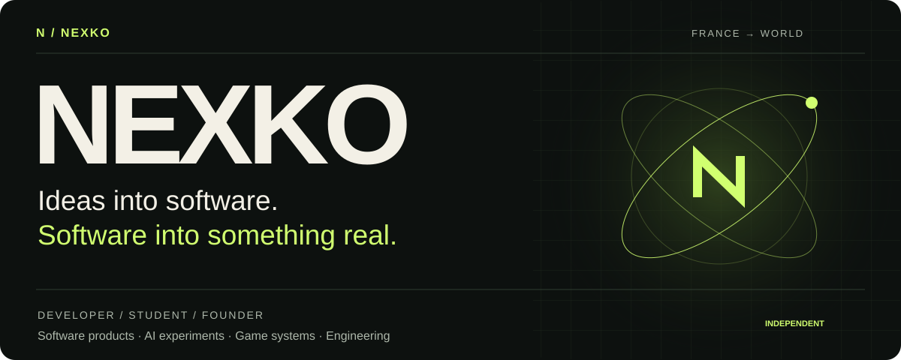
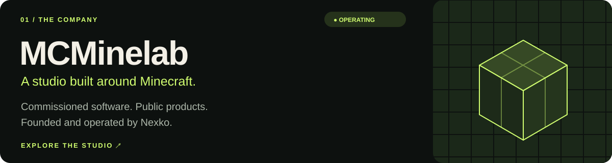
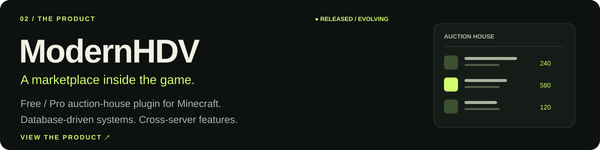
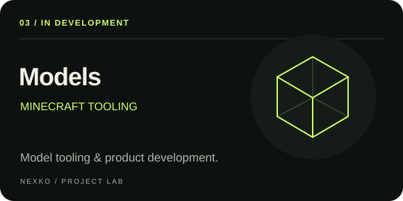
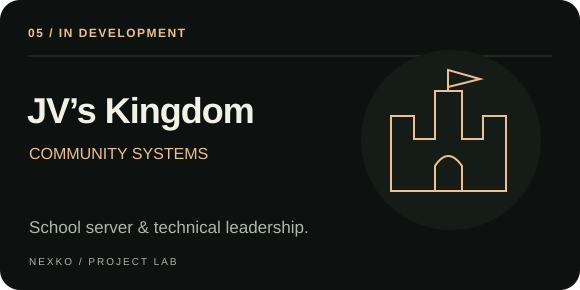
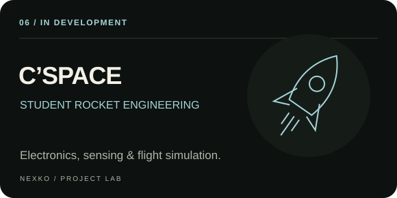
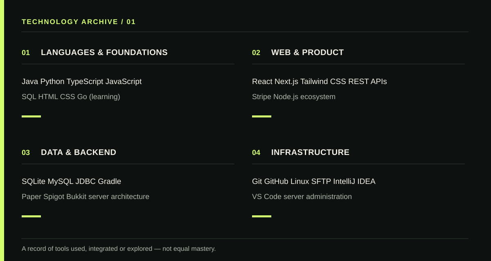
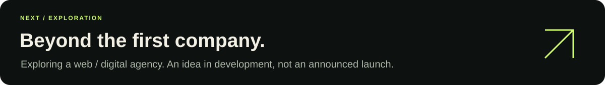

<h1 align="center">Nexko — software, systems & companies</h1>

<a href="https://mcminelab.fr"><strong>MCMinelab ↗</strong></a> &nbsp; / &nbsp;
<a href="#selected-work">Selected work</a> &nbsp; / &nbsp;
<a href="#toolbox">Toolbox</a> &nbsp; / &nbsp;
<a href="mailto:contact@mcminelab.fr">Get in touch ↗</a>

 

I'm **Nexko**, a developer, student and founder based in France. I build software products, experiment with local AI, and work on systems that connect code to games, communities and hardware.

I founded **[MCMinelab](https://mcminelab.fr)**, a Minecraft software studio. My interests extend from shipping useful products to designing electronics and exploring what my next company could become.

 

## Selected work

**Founder & operator.** Building commissioned Minecraft software and public products through my first company.

**[ModernHDV ↗](https://mcminelab.fr/plugins/modernhdv)** brings auction-house functionality to Minecraft servers, with Free and Pro editions.

 

### In the lab

Experiments and projects in development, from Minecraft tooling to embedded engineering.

<table>
<tr>
<td width="50%" valign="top">

<strong>Models</strong> 
Minecraft-focused model tooling and product development. Not released.
</td>
<td width="50%" valign="top">

<strong>Athéna</strong> 
A local, voice-first AI assistant exploring tools, scheduled actions and personal workflows.
</td>
</tr>
<tr>
<td width="50%" valign="top">

<strong><a href="https://www.instagram.com/kingdomjv/">JV's Kingdom ↗</a></strong> 
Technical leadership: Paper backend, kingdoms, economy, claims and Java/Bedrock interoperability.
</td>
<td width="50%" valign="top">

<strong>C'SPACE</strong> 
Student mini-rocket project spanning PCB design, pressure sensing, embedded electronics and flight simulation.
</td>
</tr>
</table>

 

## Toolbox

| Area | Technologies & ecosystems |
| :--- | :--- |
| **Languages** | Java · Python · TypeScript · JavaScript · SQL · HTML · CSS |
| **Web & product** | React · Next.js · Tailwind CSS · Node.js · REST APIs · Stripe |
| **Backend & game systems** | SQLite · MySQL · JDBC · Gradle · Paper · Spigot · Bukkit |
| **AI & automation** | LLM APIs · AI agents · Silero VAD · Voice processing |
| **Hardware & flight** | Raspberry Pi Pico 2 · Arduino · BMP388 · KiCad · OpenRocket |
| **Tools & infrastructure** | Git · GitHub · Linux · SFTP · IntelliJ IDEA · VS Code |

**Currently exploring:** Go, autonomous workflows, hardware integration and system design.

<strong>Open the full technology archive</strong>

 

These are tools and ecosystems I've used, integrated or explored, with varying levels of experience. Go is a learning focus; MCP is a conceptual exploration.

 

## Beyond code

MCMinelab is my first company. I'm also exploring a **web / digital agency** as a possible next venture.

 

### Let's build something useful.

For commissioned Minecraft software and business enquiries: **[contact@mcminelab.fr](mailto:contact@mcminelab.fr)**.

[MCMinelab ↗](https://mcminelab.fr) &nbsp; · &nbsp; [GitHub ↗](https://github.com/Nexkoo)

 

