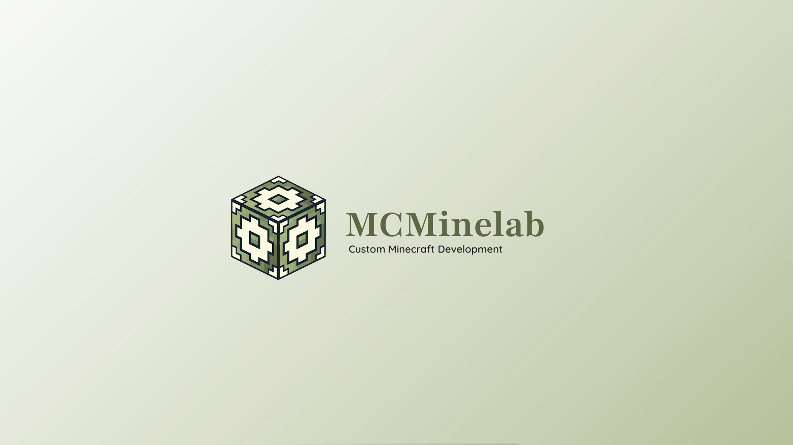
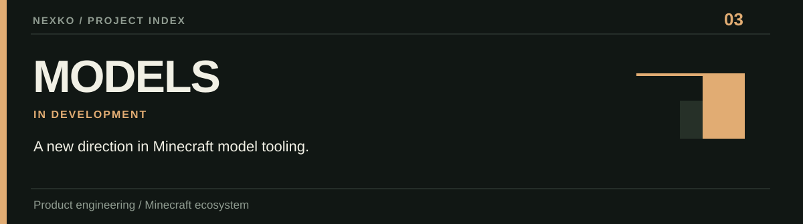
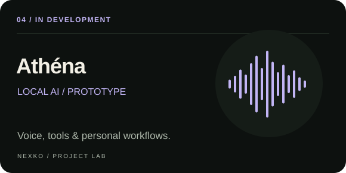
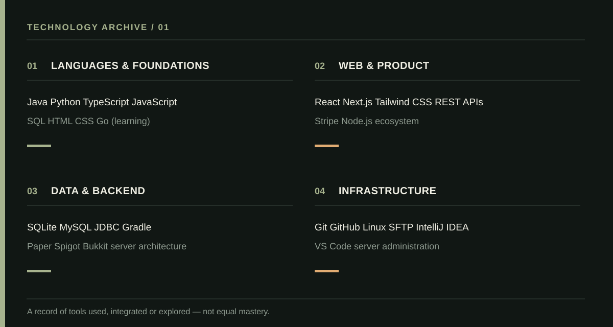
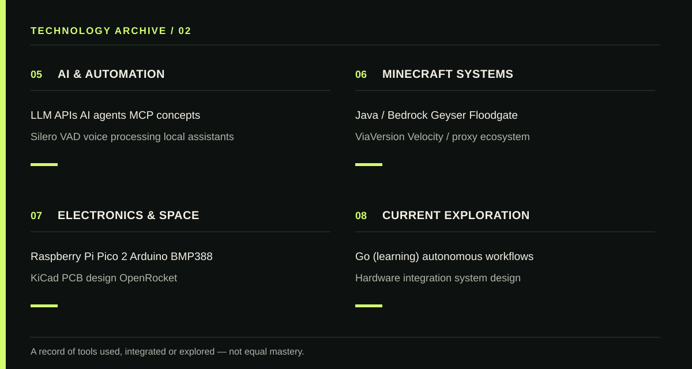

 

I'm **Nexko** ([@Nexkoo](https://github.com/Nexkoo) on GitHub) — a developer, student and founder based in France.
I build software products, AI experiments, game systems and engineering projects. I started **[MCMinelab](https://mcminelab.fr)**, a real software business, and I'm interested in what comes after it.

**Focus:** shipping real products · engineering systems · learning across disciplines · building companies

---

### 01 — Selected work

**01 / [MCMinelab](https://mcminelab.fr)** — Founded and operate a Minecraft software studio, building commissioned software and public products. **Operating business.**

<a href="https://mcminelab.fr/plugins/modernhdv">**02 / ModernHDV — Product website ↗**</a>  
Free / Pro Minecraft auction-house plugin, with database-driven systems and cross-server features. **Released / evolving.**

**03 / Models** — Minecraft-focused model tooling and product development. **In development; not released.**

**04 / Athéna** — Local, voice-first AI assistant exploring tools, scheduled actions and personal workflows. **In development / prototype.**

**05 / [JV's Kingdom — Instagram ↗](https://www.instagram.com/kingdomjv/)** — Technical leadership on a school Minecraft community: Paper backend, kingdoms, economy, claims and Java/Bedrock interoperability. **In development.**

**06 / C'SPACE** — Student mini-rocket work spanning PCB design, pressure sensing, embedded electronics and flight simulation. **In development; no public project link yet.**

---

### 02 — Technology archive

<strong>How to read this archive</strong>

These are technologies, ecosystems and tools I have worked with, integrated or explored. They are **not** all at the same proficiency level. Go is explicitly marked as learning; concepts and ecosystems are distinguished from production tools. This is a growing archive, not a certification list.

---

### 03 — Beyond code

**MCMinelab** is my first company. I'm also exploring a **web / digital agency** as a possible next business. It's an idea in development, **not** an existing subsidiary or announced launch.

---

### 04 — Activity

GitHub stats may not reflect work in private repositories, and third-party images can occasionally be unavailable.

---

**Find me:** [MCMinelab](https://mcminelab.fr) · [GitHub](https://github.com/Nexkoo) · [Business email](mailto:contact@mcminelab.fr)

